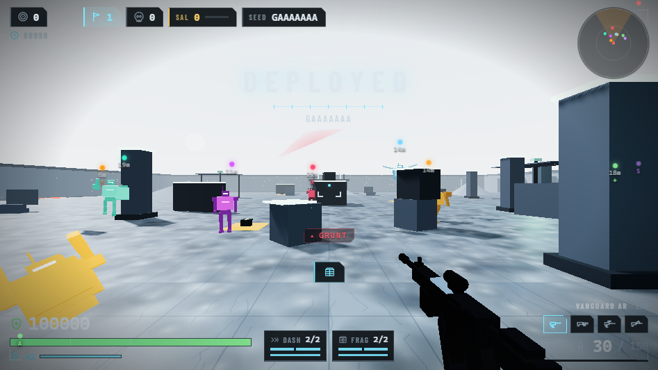
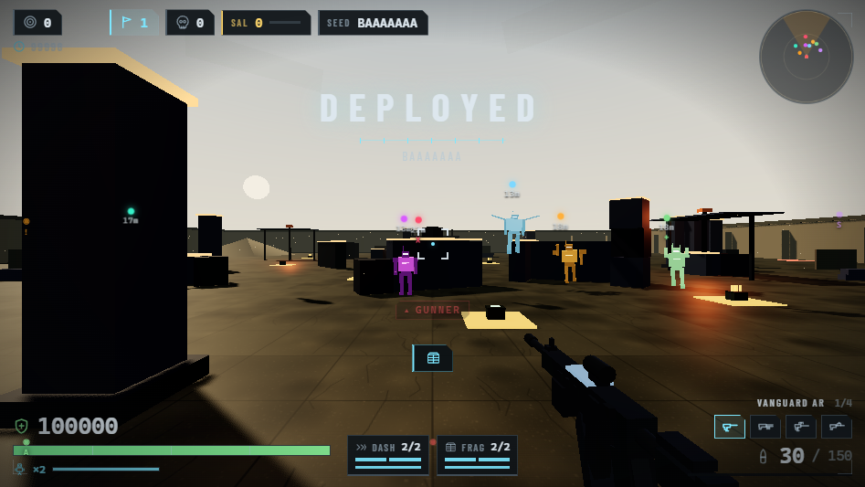
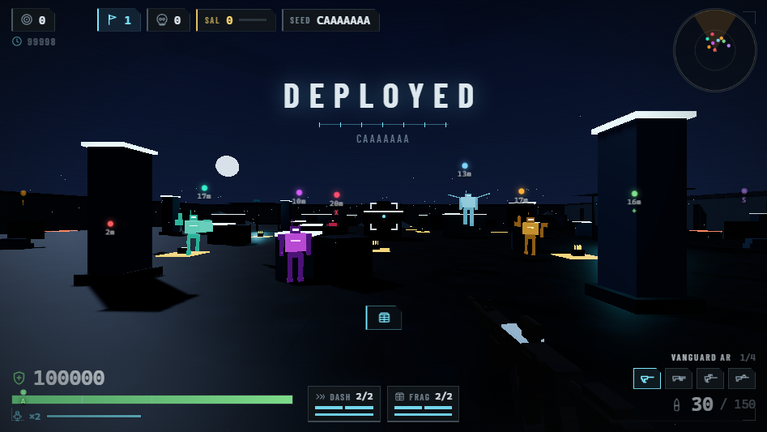
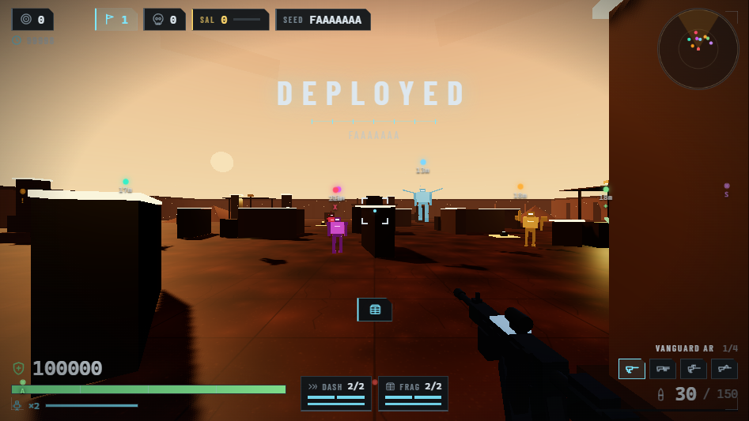
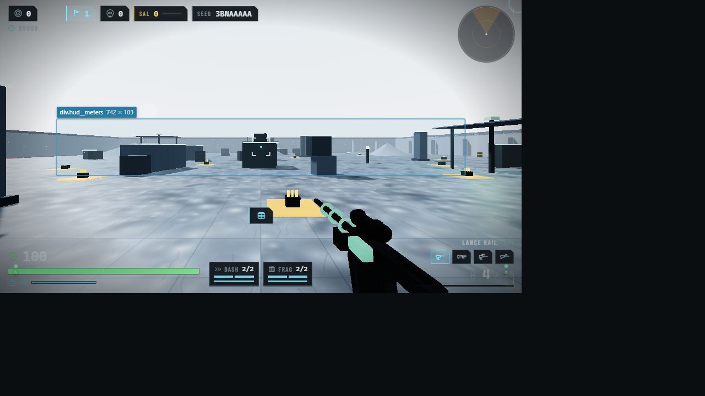
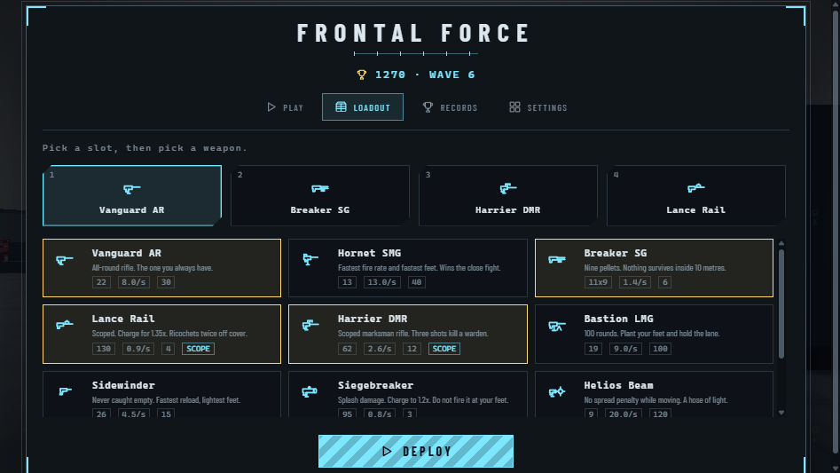
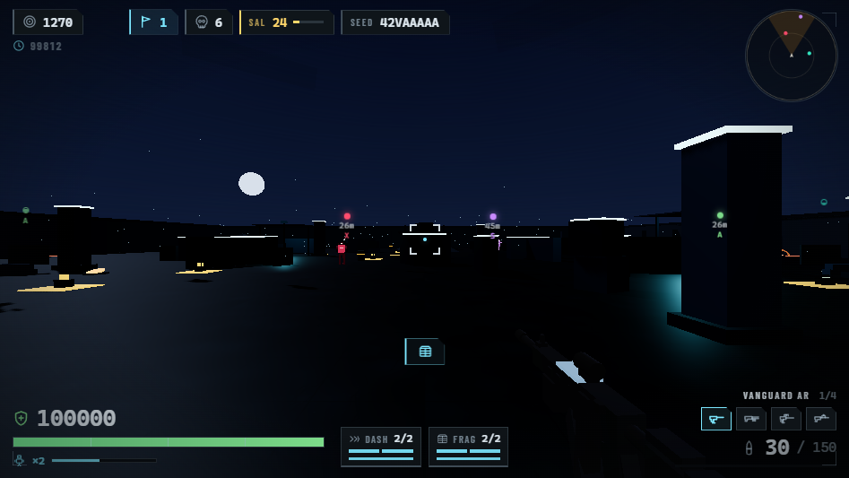

# Frontal Force

A fast browser FPS. You hold a neon arena against endless waves of grunts, snipers, flyers, exploders, healers, summoners, shield wardens, and a three-phase boss. Between waves you draft upgrades, buy gear with salvage, and the arena itself mutates around you.

Built with Three.js, TypeScript, and Vite. Every visual is procedural and every sound is synthesized with WebAudio, so the whole game is source code and no external assets.

**Play it:** https://fawwaz1st.github.io/frontal-force/



---

## Four arenas, chosen by your seed

The map is part of the seed code, so a shared seed reproduces both the layout and the place. Each theme changes the palette, sky, fog, light colour, and cover density. Consecutive seeds are spread by an avalanche hash, so the rotation never looks like "next".

| Dawn Range | Night Yard | Rust Works | Frost Line |
| --- | --- | --- | --- |
|  |  |  |  |
| Cold light, long shadows, normal cover. | Dark and tight, lit by work lamps. Denser cover. | Hot haze over dead machinery. Densest cover. | White ground, blue air, sparse cover and long sight lines. |

## Scope, charge, and ricochet

Every weapon has a real aimed FOV, and two carry a magnified optic with a scope overlay. The rail also charges for a bigger hit and ricochets twice off cover.



## A four-slot loadout, chosen once

Ten weapons exist; you carry four. The loadout screen is where the arsenal lives, so mid-fight you are deciding when to swap, not scrolling a list.



## Run locally

```bash
npm install
npm run dev         # dev server on http://localhost:5173/
npm run build       # typecheck + production build (GitHub Pages base path)
npm run preview     # serve the production build at /frontal-force/
npm run check       # typecheck only
npm run check:self  # 99 logic regression tests, no browser needed
```

`npm run preview` serves the same URLs GitHub Pages serves, so a base-path mistake fails locally instead of in production.

## Deploy

Pushing to `main` deploys automatically through `.github/workflows/deploy.yml`:

1. `npm ci`
2. `npm run build` (a type error fails the deploy)
3. `npm run check:self`
4. `actions/configure-pages` with `enablement: true`, so the first deploy turns Pages on by itself
5. upload `dist/` and deploy to the `github-pages` environment

The base path is read from `GITHUB_REPOSITORY`, so renaming the repository does not require editing the config.

## Controls

| Input | Action |
| --- | --- |
| WASD | Move |
| Mouse | Aim |
| LMB | Fire |
| RMB | Aim down sights (scopes the magnified optics) |
| Space | Jump |
| Shift | Sprint |
| C / Ctrl | Crouch. Press while sprinting to **slide** |
| R | Reload |
| 1-4 / wheel | Switch weapon (your four slots) |
| Shift+W / double-tap W | Dash (2 charges, 0.12 s invulnerability) |
| G (hold to cook, release to throw) | Grenade: frag, smoke, or EMP |
| F | Cycle grenade kind |
| V | Melee: 42 damage, executes below 15 % health for an 18 HP heal |
| Esc / P | Pause |

**Touch:** the left 45 % of the screen is a floating stick, dragging the right side looks around (slowed to 45 % while aiming), and on-screen buttons cover fire, jump, reload, crouch, dash, grenade, and melee. The layout respects safe-area insets on notched phones and the HUD switches to a touch layout on first contact.

## Reading the screen



- **World markers.** Every enemy and ally carries a marker: a dot filled to its health, coloured by enemy kind (the same hues the radar uses), with a glyph for the ones that change how you fight (`X` sniper, `+` healer, `S` summoner, `!` exploder, `E` elite, `B` boss, `A` ally). Off-screen markers clamp to the edge and hollow out.
- **Named damage.** Every source that can hurt you names itself: the arc shows *where* the hit came from, the label under the crosshair shows *what* did it (`▲ EXPLODER`, `▲ TESLA COIL`, `▲ BARREL BLAST`, `▲ AFFIX BURN`, `▲ YOUR OWN BLAST`, or the shooter's kind for a bolt).
- **Radar** for the wider picture, at 20 Hz so it costs a third of a 60 Hz redraw.

## The run loop

1. **Fight a wave.** Enemies spawn from points that respect line of sight to your position.
2. **Clear it.** A clean, fast clear pays a medal (GOLD / SILVER / BRONZE) and bonus score.
3. **Draft a card.** Three offers from 40 upgrades, with rarity weights that shift toward rare and legendary as the run goes on. Rerolls cost salvage.
4. **Spend salvage.** Every third wave the kiosk opens first: field repair, a full armory refill, an extra draft reroll, reactive plating, and sell-back for any upgrade you regret (40% of its value, paid back as salvage).
5. **Repeat**, with the arena mutating every few waves.

Death shows the full run summary: accuracy, headshots, damage dealt and taken, longest combo, elites and bosses killed, salvage earned, no-hit waves, the seed, and the mutations you saw. The seed is copyable and re-deployable, so a run can be raced or shared.

## Modes

| Mode | Behavior |
| --- | --- |
| STANDARD | Classic wave pacing, 6 s breaks. |
| BLITZ | 3.5 s breaks, denser spawns, x1.35 score. |
| ONSLAUGHT | Heavy waves from wave 2, x1.75 score. |
| ROTATION | Weapon swaps on every kill, x1.5 score. |
| OVERRUN | Endless: 24-alive cap, HP x1.12^(wave-1) capped at x40, speed capped x1.30, spawn cadence x0.94^(wave-1) with a 0.25 s floor. Player damage scales on the same curve so the mode cannot wall out. Own best-wave record. |

**Daily run:** a date-derived seed, so every player on the same UTC day gets the same arena, spawn order, and card offers.

## Challenge wagers

Optional difficulty modifiers picked in the menu before deploying. Each one is a bet: the run gets harder in a specific, readable way and pays a score multiplier. Payouts compound, so stacking three is a real gamble (Horde x1.45 plus Glass Cannon x1.30 is x1.885, not x1.75).

| Wager | Effect | Payout |
| --- | --- | --- |
| Glass Cannon | You take double damage. | +30% score |
| Ironclad | Enemies have 40% more health. | +30% score |
| Famine | You start with half the reserve ammo. | +20% score |
| Relentless | Enemies move 20% faster. | +25% score |
| Scatter | Your weapon cone is 60% wider. | +25% score |
| Horde | Waves spawn 50% more enemies and elites gain an extra affix. | +45% score |

The selection persists between sessions, shows a live payout readout in the menu, and stays visible mid-run as a HUD chip so you can always see what you signed up for.

## Enemies

| Enemy | Behavior |
| --- | --- |
| Grunt | Baseline rifleman. Matte scavenged plates. |
| Rusher | Fast melee flanker that commits to a charge, and slides the last few metres. Bare frame, almost no plate. |
| Gunner | Slow, long-range cannon with heavy bolts. Wide, thick industrial plating. |
| Warden | 180 HP mid-range shooter behind a riot shield. Frontal shots inside a +/-60 deg cone land at 50 % and charge a 6-block guard meter that breaks for 1.2 s; flank shots deal x1.5. The shield also drops during its 0.45 s wind-up, so trading the telegraph is the counter-play. Polished ceramic plate. |
| Sniper | Long-range one-shot threat: a laser telegraph, then a fast hard-hitting bolt. Narrow, small-headed, almost matte black. |
| Flyer | Drone that ignores cover and orbits at head height. Thin glossy composites. |
| Exploder | Charges and detonates; killing it early is the counter-play. The glowing charge tank is the threat, readable from the silhouette. |
| Healer | Fragile support healing 3 %/s to every enemy within 9 m, which changes target priority. The only bright white body on the field. |
| Summoner | Spawns a grunt every 6 s and ignores the player to keep the pipeline running. Deep violet lacquer, tall and thin. |
| Warden Prime | Boss on every fifth wave. 2200 HP, three phases, a glowing rear core that takes x2.5 damage. Enough rear-core damage (18% of max health, post-multiplier) destroys the core permanently, so flanking it is a real objective rather than a temporary bonus. Gold-plated and self-lit. |

Every kind carries its own **armour look**: plate tint, roughness, metalness, body glow, and plate glow (`ARMOR_LOOK`), plus its own **proportions** (`PROPORTION`: shoulder width, pad size, head scale). Ten archetypes sharing one gunmetal frame with a coloured strip was why the roster read as the same model ten times.

### Affixes

From wave 4, elites spawn with 1 to 3 affixes rolled from 14: Blazing, Overloading, Glacial, Mending, Juggernaut, Hasted, Gilded, Splitting, Vampiric, Volatile, Regenerating, Armored, Shrouded, Charged. Each one changes how a fight has to be fought: Splitting copies split on death, Volatile explodes, Glacial slows, Blazing burns, and Armored trades flat reduction for a slower, tankier target.

## AI

- **Threat table.** The player and both escorts implement `CombatTarget` (`src/combat/Combatant.ts`). Enemies score every visible candidate with a weighted utility function (proximity 0.30, role 0.20, aggression/grudge 0.20, fragility 0.15, aimPressure 0.15) and commit to the best one.
- **Stickiness.** 0.25 s staggered re-score, 1.25x switch hysteresis, 1.5 s minimum commitment, two perception radii to stop boundary flicker, 6 s alerted memory, and a squad alert that propagates on damage in O(n).
- **Agility.** Three short committed bursts punctuate the walk cycle instead of replacing it: a **dodge** (0.32 s, x2.35 speed) fired reactively the moment an agent takes fire, aimed to whichever side of the shot line it already occupies so it never runs into the stream; a **juke** (0.26 s, x2.1) that breaks a straight approach on a staggered 1.4-3.6 s cadence; and a **slide** (0.55 s, x2.9) used only by rushers and exploders, only inside a 9 m commit window. A burst owns movement outright for its duration and the body drops and pitches through it, so a dodge reads as a dodge and not as a slightly faster strafe. Staggered agents and flyers never burst.
- **Projectile ownership.** A bolt carries the id of the friendly it was aimed at, so a stray round never hits a bystander.
- **Escorts are autonomous.** Anchor + leash + role slot: the owner position is quantized to a 3 m grid and used only as an idle anchor. Soft leash 18 m, hard leash 26 m, squad role auction every 2 s (flanker <=12 m, overwatch 10-20 m, opposite orbit signs), and self-preservation that retreats under 30 % HP and re-engages at 55 %.

## Arena hazards

Explosive barrels (7 per arena, 60 HP, 4.5 m blast for 120 damage), tesla coils, and flame vents. Barrels can be shot to clear a crowd, and barrel kills count toward the run summary and a dedicated achievement.

## Grenades

Three kinds, cycled with `F` and thrown with `G` (hold to cook, release to commit).

| Grenade | Effect |
| --- | --- |
| Frag | 130 damage at the centre, linear falloff to a 30% floor over 4.6 m. |
| Smoke | A live cloud that blocks enemy line of sight, so it breaks pursuit and firing lanes. |
| EMP | 25 damage and disables warden plates and the boss shield for the duration. |

Enemies also carry affix riders that fire when they hit you: Blazing sets you burning for 4 damage per second, Glacial slows your movement, and Charged arcs a visible burst.

## Arsenal

Ten weapons (`src/combat/weapons.ts`), four equipped at a time. Each one has a full stat block plus an aimed FOV, a scope flag, a movement weight, and a role line that the loadout screen shows.

| Weapon | Role |
| --- | --- |
| Vanguard AR | Baseline auto rifle. |
| Hornet SMG | Fast, close, wide spread, and the lightest feet (+8% move). |
| Breaker SG | 9-pellet burst, 40 m ceiling. |
| Lance Rail | 130-damage precision single shot. **Scoped** (18 deg), **charges** 0.6 s for x1.35, **ricochets twice** off cover. |
| Harrier DMR | Three-taps a warden while still one-shotting a grunt. **Scoped** (26 deg). |
| Bastion LMG | 100-round lane holder, 3.3x the AR's base spread, heaviest gun (-18% move). |
| Sidewinder | 105-round pool, fastest reload, lightest of all (+12% move). |
| Siegebreaker | 4 m splash with linear falloff to a 35 % floor, plus a separate 3.2 m self-damage radius capped at 35. **Charges** 0.4 s for x1.2. |
| Helios Beam | 0.012 moving spread: the only weapon that does not degrade while strafing. |
| Trident Burst | Three sequential rounds (~288 rpm); ten trigger pulls per 1.8 s reload. |

The HUD shows all four equipped slots at once, plus the `n/4` index, and a charge ring for the weapons that charge.

### Loadout rules

- Four slots (`LOADOUT_SLOTS`), persisted in the save.
- Choosing a weapon already in another slot **swaps** the two positions rather than duplicating it.
- `sanitizeLoadout` drops unknown and duplicate ids and pads from the default kit, so a save from an older build can never leave you unarmed.
- Movement weight applies to every ground speed including the slide, so the loadout has a real cost and the choice cannot collapse to "most damage".

## Precision model

Accuracy is treated as a system, not a stat:

- **The first shot of a burst is perfectly accurate** while stationary and grounded. Sustained fire blooms the cone; the bloom resets with the group and on reload.
- **Movement penalty scales with actual velocity**, so counter-strafing works the way players expect.
- **The ray leaves the eye, not the muzzle.** The crosshair is the aim point at every range; the muzzle is used only for tracers, muzzle flash, and brass.
- **The crosshair gap is derived from the projection**, so the reticle shows the real cone instead of a fixed size.
- **The aim is sampled before this shot's recoil is applied.** Recoil rotates the same pitch/yaw the shot reads, so applying it first would deflect the round by its own kick. A regression test locks this ordering in.
- **Hitboxes are a capsule plus a head sphere** at 88 % body height with a 1.15x radius, so a headshot is a real geometry test rather than a Y-threshold.
- **Damage reported is post-mitigation.** A shield that eats half a round, flat armor, or an overkill execute cannot inflate damage-dealt or lifesteal.

## Progression

- **40 upgrade cards** across three rarities (common, rare, legendary) with stacking caps, including on-kill, on-crit, lifesteal, blast, ricochet, and movement modifiers.
- **35 achievements** with lifetime counters persisted across sessions: headshot counts, accuracy bests, kill streaks, no-hit waves, barrel kills, melee kills, dash kills, daily runs, and style ranks.
- **Style rank D to SSS**, ULTRAKILL-style: kill rate and headshot accuracy raise it, taking damage demotes it.
- **Kill combo** with an x8 cap, refreshed per kill and decaying after a 3 s window.

## Architecture

```
src/
  core/     loop.ts (fixed timestep + spiral guard) · math.ts · storage.ts (save schema v1) · quality.ts (tier detect + frame governor) · rng.ts (seeded, deterministic)
  input/    Input.ts (keyboard/mouse/pointer-lock + touch fallback) · TouchControls.ts (pointerId map, stick, buttons)
  player/   Player.ts (capsule movement, look, recoil, crouch/slide, dash, shield)
  combat/   weapons.ts (10 defs + 4-slot loadout rules) · WeaponController.ts (fire/reload/switch/charge/ricochet/hitscan/spread) · Combatant.ts (CombatTarget + threat scoring) · Grenades.ts (frag/smoke/EMP)
  ai/       Enemies.ts (AI, affix hooks, projectiles, boss phases, radar feed) · Affixes.ts (14 elite modifiers) · Ally.ts (escort bots) · Tactics.ts (cover claims)
  game/     Game.ts (orchestrator) · Run.ts (seeded run state + stats) · Waves.ts (modes, mutations, boss cadence) · Challenges.ts (6 difficulty wagers) · Upgrades.ts (40 cards) · Achievements.ts · AchievementCounters.ts
  ui/       Hud.ts (HUD, menu, death card, ledger) · Draft.ts (card picker) · Kiosk.ts (salvage shop) · icons.ts (inline SVG set)
  world/    World.ts (arena, octree, cover) · Maps.ts (4 arena themes) · Hazards.ts (barrels/tesla/vents) · Pickups.ts
  render/   Effects.ts (pooled particles, tracers, decals) · Viewmodel.ts (first-person weapon)
  audio/    Audio.ts (synthesized WebAudio: weapons, impacts, music)
```

Data flows one way: `Input -> Game -> simulation modules -> HudState -> Hud (DOM)`. Modules never reach into the HUD; the HUD never touches simulation state.

### Design rules the code follows

- **Fixed timestep simulation, interpolated rendering.** The sim runs at a fixed rate with a spiral guard; the camera interpolates between ticks, so aim stays smooth on high-refresh displays and shots resolve against the tick that fired them.
- **Everything random is seeded.** The arena layout, the arena THEME, spawn order, card offers, and affix rolls all come from the run seed, which is why a seed code reproduces a run.
- **A theme may change looks, never the rules.** `applyTheme` only writes material and light properties. Geometry, the collision octree, and cover claims are identical across themes, so a new map can never invalidate what a player learned about cover.
- **Every health point is attributable.** Anything that can damage the player passes a source label, and the HUD prints it. "I lost health and I do not know why" is a bug, not a difficulty.
- **A dark map still has to be playable.** A test asserts a luminance floor for every theme, because a night that hides the enemies is a bug wearing atmosphere as a disguise.
- **Zero external assets.** Geometry, materials, icons, and audio are generated in code.
- **Measured, not guessed.** `scripts/self-check.ts` locks formulas (endless curves, combo tiers, warden cone math, challenge fold math, save schema, fire ordering, slide gating, stand-up probe ordering, theme index range, theme luminance floor, loadout sanitising, charge gating, ricochet bounds) and runs in CI before every deploy.

## Performance

- Adaptive quality tiers (low / medium / high) with a frame-time governor that steps down when frames run long, and a manual override in the settings panel.
- The sun's shadow map is baked once for the static arena and re-armed only when quality changes.
- Direct meshes are merged, effects are pooled, and hot-path HUD writes are cached so unchanged values never touch the DOM.
- On Windows, Chrome may log a `powerPreference` warning from the WebGPU adapter request. It is a browser notice, not a game error.

## License

No license file is included; treat the source as all rights reserved unless the repository owner states otherwise.
