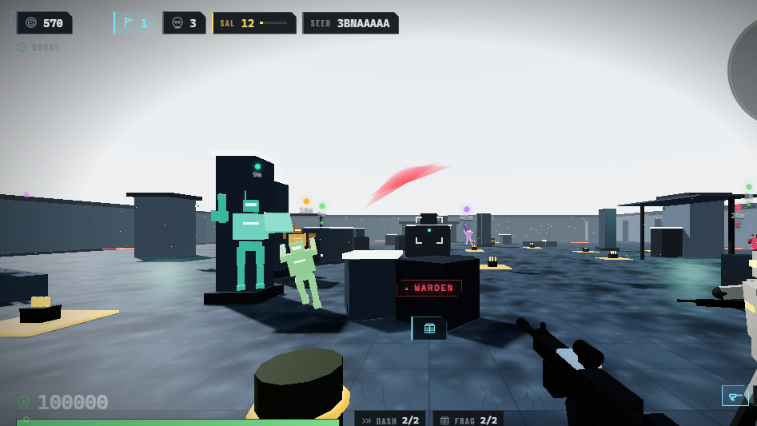
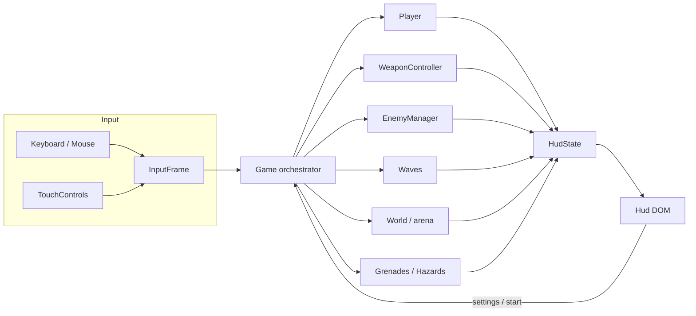
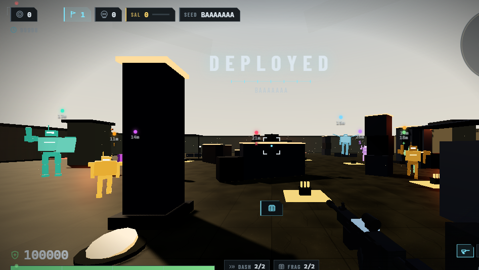
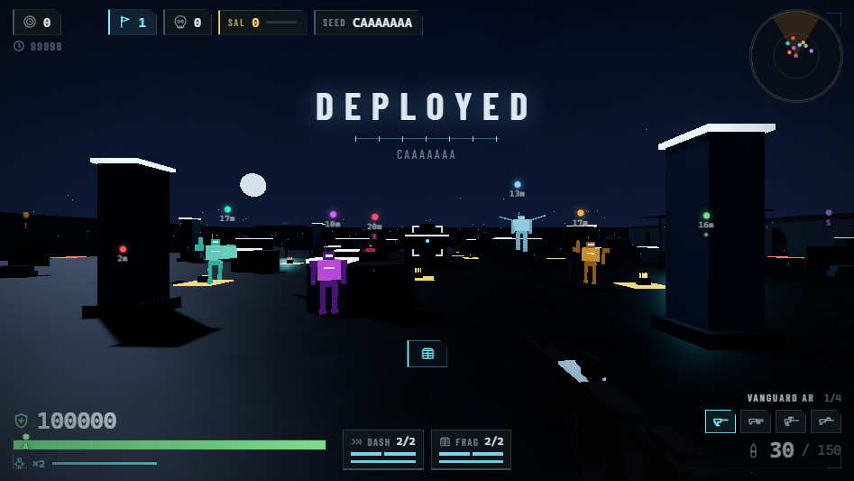
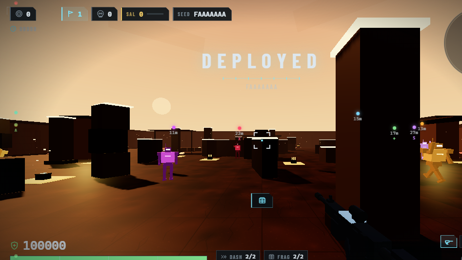
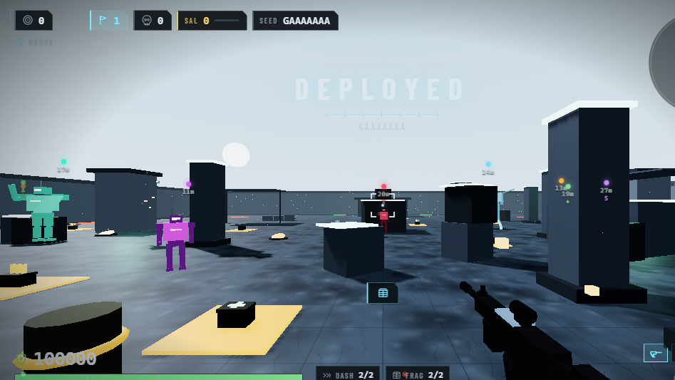
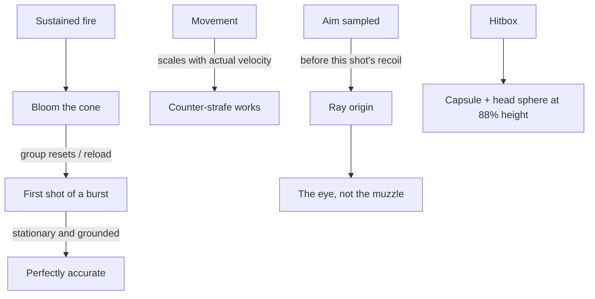
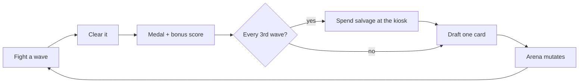

# FRONTAL FORCE

A browser FPS wave-survival roguelite. Hold an arena, draft upgrades between waves, and watch the place change around you.

**Play:** https://fawwaz1st.github.io/frontal-force/ · **Stack:** Three.js (WebGPU) · TypeScript · Vite · zero external assets

---

## At a glance

| | |
| --- | --- |
| Genre | Wave-survival FPS roguelite |
| Render | Three.js WebGPURenderer, post pipeline (bloom, vignette, FXAA) |
| Assets | Procedural geometry, synthesized audio, no downloaded files |
| Loadout | 3 of 10 weapons |
| Arenas | 4 themes, selected by the run seed |
| Enemies | 10 archetypes + 14 elite affixes + 1 three-phase boss |
| Modes | Standard, Blitz, Onslaught, Rotation, Overrun |
| Tests | 222 wiring · 30 runtime |

---

## Visual language



The build ships in a neon instrument palette: cyan for state, gold for currency, red for harm, green for recovery. Every hue carries one meaning, and the HUD rationes them.

| Token | Meaning |
| --- | --- |
| Cyan | Interactive, current, aim |
| Gold | Currency, reward, record |
| Red | Damage, empty magazine, death |
| Green | Health, recovery, station |
| White | Neutral information |

---

## Systems



Data flows one way. Simulation modules never touch the DOM; the HUD never mutates simulation state. The only return path is an intent: `onSettings`, `onStart`, `onSlotTap`.

---

## Arena themes

| Dawn Range | Night Yard | Rust Works | Frost Line |
| --- | --- | --- | --- |
|  |  |  |  |
| Cold light, long shadows, normal cover | Dark and tight, lit by work lamps, dense cover | Hot haze over dead machinery, densest cover | White ground, blue air, sparse cover, long sight lines |

The map is part of the seed. A shared code reproduces the layout, the theme, the spawn order, and the card offers.

---

## Arsenal

| Weapon | Role | Weight |
| --- | --- | --- |
| Vanguard AR | Baseline auto rifle | 1.00 |
| Hornet SMG | Fast, close, wide spread | 0.92 |
| Breaker SG | 9-pellet burst, 40 m ceiling | 1.00 |
| Lance Rail | 130-damage precision. Scoped, charges 0.6 s, ricochets twice | 1.10 |
| Harrier DMR | Three-taps a warden, one-shots a grunt. Scoped | 1.05 |
| Bastion LMG | 100-round lane holder, 3.3x base spread | 1.18 |
| Sidewinder | 105-round pool, fastest reload | 0.88 |
| Siegebreaker | 4 m splash, self-damage radius capped at 35. Charges 0.4 s | 1.12 |
| Helios Beam | 0.012 moving spread, the only gun that does not bloom while strafing | 1.00 |
| Trident Burst | Three sequential rounds, ~288 rpm | 0.95 |

Movement weight applies to every ground speed including the slide, so a loadout has a real cost.

---

## Enemy roster

| Enemy | Behaviour | Read |
| --- | --- | --- |
| Grunt | Baseline rifleman | Matte scavenged plates |
| Rusher | Fast melee flanker, commits to a charge | Bare frame, almost no plate |
| Gunner | Slow long-range cannon, heavy bolts | Wide thick industrial plating |
| Warden | Riot shield. Frontal shots in a 60 deg cone land at 50% and charge a 6-block guard | Polished ceramic plate |
| Sniper | Laser telegraph, then a fast hard bolt | Narrow, small-headed, near-black |
| Flyer | Drone that ignores cover, orbits at head height | Thin glossy composites |
| Exploder | Charges and detonates; kill it early | Glowing charge tank |
| Healer | Heals 3%/s to enemies within 9 m | The only bright white body |
| Summoner | Spawns a grunt every 6 s, ignores the player | Deep violet lacquer, tall and thin |
| Warden Prime | Boss every fifth wave. 2200 HP, three phases, rear core at 2.5x | Gold-plated and self-lit |

Affixes roll from wave 3: Blazing, Overloading, Glacial, Mending, Juggernaut, Hasted, Gilded, Splitting, Vampiric, Volatile, Regenerating, Armored, Shrouded, Charged. Each one changes how a fight must be fought.

---

## Precision model



- The crosshair gap is the real cone projected to pixels, not a fixed size.
- Damage reported is post-mitigation. Armor and overkill cannot inflate the stats.
- Hitstop freezes the sim at 0.12 scale for 60 to 160 ms. The renderer keeps running, so a kill reads as a punch and never a stutter.

---

## Feedback

| Event | Response |
| --- | --- |
| Hit | Hitmarker, flinch away from the shooter, white flash, damage number at the hit point |
| Headshot | Larger gold hitmarker, 2x damage, bonus damage number |
| Kill | Three beats: impact squash, topple with a little spin, settle while the glow drains |
| Blocked | Separate blocked hitmarker, no combo reset, no damage flash |
| Low HP | Pulsing red vignette, heartbeat audio bed |
| Wave clear | Hitstop, medal banner, slow-motion beat, salvage payout |
| Damage taken | Directional arc, named source label under the crosshair |

---

## Audio

All synthesized with WebAudio. Every sound layers five primitives: a transient click, a filtered noise body, a pitched thump, a tonal tail, and a room send.

| System | What it does |
| --- | --- |
| Procedural room | Generated impulse response on a convolver; each voice decides its own send |
| Distance | Far shots lose the room tail, because the tail is the distance cue |
| Listener frame | Pan resolves against player position and yaw, so sound stays on the correct side |
| Near miss | A bolt passing within 1.4 to 3.4 m whizzes past, panned to its side |
| Material impacts | Concrete ticks, metal rings, fabric thuds, glass splinters |
| Room tone | Filtered noise bed plus a detuned sub, faded in with the run |
| Saturated master | Soft-clip WaveShaper before the compressor, so 24 guns compress instead of clipping |
| Voice attack | Every voice opens over 2 to 8 ms, because an instant jump reads as a tick |
| Unfrozen noise | Every noise voice reads from a random buffer offset |

---

## Controls

| Input | Action |
| --- | --- |
| WASD | Move |
| Mouse | Aim |
| LMB / RMB | Fire / aim down sights |
| Space | Jump |
| Shift | Sprint |
| C or Ctrl | Crouch; press while sprinting to slide |
| R | Reload |
| 1-3 / wheel | Switch weapon |
| Q | Dash (2 charges, 0.12 s invulnerability) |
| G | Grenade: hold to cook, release to throw. A tap cycles frag / smoke / EMP |
| F or V | Melee: executes below 15% health for an 18 HP heal |
| Esc or P | Pause |

Touch: a floating stick on the left 45%, drag-look on the right, and 10 on-screen buttons. The layout derives from the viewport with a 61 px tap floor, so no phone gets an overlap or an unreachable button.

---

## Run loop



1. **Fight.** Enemies spawn from points that respect line of sight.
2. **Clear.** A clean fast clear pays GOLD, SILVER, or BRONZE.
3. **Draft.** Three offers from 42 upgrades, with rarity weights that shift toward rare and legendary.
4. **Spend.** Every third wave the kiosk opens first: repair, armory refill, extra reroll, reactive plating, and sell-back at 40%.
5. **Repeat.** The arena mutates every few waves.

Death shows the full run summary and a copyable seed.

---

## Modes

| Mode | Behaviour |
| --- | --- |
| Standard | Classic pacing, 6 s breaks |
| Blitz | 3.5 s breaks, denser spawns, x1.35 score |
| Onslaught | Heavy waves from wave 2, x1.75 score |
| Rotation | Weapon swaps on every kill, x1.5 score |
| Overrun | Endless: 24-alive cap, HP x1.12^(wave-1) capped at x40, player damage on the same curve, own best-wave record |

**Daily run:** a date-derived seed, so every player on the same UTC day gets the same arena, spawn order, and offers.

---

## Wagers

| Wager | Effect | Payout |
| --- | --- | --- |
| Glass Cannon | You take double damage | +30% score |
| Ironclad | Enemies have 40% more health | +30% score |
| Famine | You start with half the reserve ammo | +20% score |
| Relentless | Enemies move 20% faster | +25% score |
| Scatter | Your weapon cone is 60% wider | +25% score |
| Horde | Waves spawn 50% more enemies, elites gain an extra affix | +45% score |

Payouts compound, so stacking three is a real gamble.

---

## Progression

| System | Detail |
| --- | --- |
| Upgrade cards | 42 across three rarities, with stacking caps |
| Achievements | 36, with lifetime counters persisted across sessions |
| Style rank | D to SSS, live in the HUD. Kill rate and accuracy raise it, damage taken demotes it |
| Kill combo | x8 cap, refreshed per kill, decays after a 3 s window |
| Supply level | The achievement ledger grants a permanent head start: salvage per level, a reroll from level 3 |
| Field guide | In-game tab with every affix, modifier, and mechanic |

---

## Testing

| Suite | Count | What it does |
| --- | --- | --- |
| `check` | - | TypeScript strict typecheck |
| `check:self` | 222 | The self-check suite: reads source text and asserts wiring, no browser |
| `check:runtime` | 30 | Transpiles and executes the real modules |

```bash
npm install
npm run dev          # http://localhost:5173/
npm run build        # typecheck + production build
npm run check:self   # wiring regression tests
npm run check:runtime
```

Pushing to `main` deploys through `.github/workflows/deploy.yml`.

---

## Rebuild direction

The next build moves to an authored asset pipeline and a single bold visual identity.

| From | To |
| --- | --- |
| Procedural geometry in code | Authored low-poly meshes, Blender to glTF |
| Sine-wave bob and sway | Keyframe animation, state machines, layered poses |
| Neon palette with many hues | High-contrast monochrome with banded toon lighting |
| Code-generated icons | One authored icon set on a grid |
| Synthesized beeps | Layered sound design with a real mix |

Target references: the silhouette discipline of Limbo and Inside, the 1-bit dither of Return of the Obra Dinn, the ink weight of Mad World, the hard-edged low-poly of Sludge Life.
